# OmniRL

English | [简体中文](README.zh-CN.md)

OmniRL is a distributed reinforcement learning framework built on Python, Ray, and PyTorch. It provides a common runtime for asynchronous sampling, replay and rollout storage, distributed learning, versioned weight synchronization, evaluation, logging, and checkpoint recovery. The framework includes 13 value-based and actor-critic algorithms for discrete and continuous control.

## Architecture

```text
Environment Collection ──► Samplers ──► Memory ──► Learners ──► WeightStore
                               ▲                                     │
                               └───────── Algorithm Policy ◄─────────┘

Environment Evaluation ◄── Evaluators ◄── Algorithm Policy ◄── WeightStore
```

- `omnirl.runtime` orchestrates Ray actors for sampling, learning, evaluation, and versioned weight synchronization.
- `omnirl.buffers` provides rollout, replay, and prioritized replay storage.
- `omnirl.algorithms` contains algorithm-specific learners and inference policies.
- `omnirl.networks` contains reusable network architectures for value-based and actor-critic algorithms.
- `omnirl.envs` owns environment construction, specifications, collection and evaluation loops, and metric aggregation.

Every algorithm package exposes the same `Learner`, `Policy`, and `Memory` interface. The runtime connects these components to the selected environment backend, keeping algorithm and environment implementations independent.

## Implemented Algorithms

| Algorithm | Family | Action space |
| --- | --- | --- |
| ✅ [Deep Q-Network (DQN)](https://arxiv.org/abs/1312.5602) | Value-based, off-policy | Discrete |
| ✅ [Double Deep Q-Network (DDQN)](https://arxiv.org/abs/1509.06461) | Value-based, off-policy | Discrete |
| ✅ [Dueling Double Deep Q-Network (Dueling DQN)](https://arxiv.org/abs/1511.06581) | Value-based, off-policy | Discrete |
| ✅ [Prioritized Experience Replay Deep Q-Network (PER-DQN)](https://arxiv.org/abs/1511.05952) | Value-based, off-policy | Discrete |
| ✅ [Categorical 51-Atom Deep Q-Network (C51)](https://arxiv.org/abs/1707.06887) | Distributional value-based, off-policy | Discrete |
| ✅ [Quantile Regression Deep Q-Network (QR-DQN)](https://arxiv.org/abs/1710.10044) | Distributional value-based, off-policy | Discrete |
| ✅ [Advantage Actor-Critic (A2C)](https://arxiv.org/abs/1602.01783) | Actor-critic, on-policy | Discrete / Continuous |
| ✅ [Proximal Policy Optimization (PPO)](https://arxiv.org/abs/1707.06347) | Actor-critic, on-policy | Discrete / Continuous |
| ✅ [Importance Weighted Actor-Learner Architectures (IMPALA)](https://arxiv.org/abs/1802.01561) | Actor-critic, off-policy | Discrete / Continuous |
| ✅ [Deep Deterministic Policy Gradient (DDPG)](https://arxiv.org/abs/1509.02971) | Actor-critic, off-policy | Continuous |
| ✅ [Twin Delayed Deep Deterministic Policy Gradient (TD3)](https://arxiv.org/abs/1802.09477) | Actor-critic, off-policy | Continuous |
| ✅ [Soft Actor-Critic (SAC)](https://arxiv.org/abs/1801.01290) | Actor-critic, off-policy | Discrete / Continuous |
| ✅ [Truncated Quantile Critics (TQC)](https://arxiv.org/abs/2005.04269) | Distributional actor-critic, off-policy | Continuous |

## Installation

OmniRL supports Python 3.10–3.12. Create a virtual environment:

```bash
python -m venv .venv
```

Activate it on Windows:

```powershell
.\.venv\Scripts\Activate.ps1
```

On Linux and macOS:

```bash
source .venv/bin/activate
```

Install OmniRL and its shared dependencies:

```bash
python -m pip install --upgrade pip
pip install -e .
```

Install the required environment backend:

```bash
# Gymnasium
pip install -r requirements/gymnasium.txt

# RLCard
pip install -r requirements/rlcard.txt

# SUMO
pip install -r requirements/sumo.txt

# ViZDoom
pip install -r requirements/vizdoom.txt
```

Each backend requirements file includes `base.txt` and can be installed directly in a fresh environment.

For GPU training, install the PyTorch build that matches the operating system and CUDA runtime, then verify CUDA availability:

```bash
python -c "import torch; print(torch.cuda.is_available())"
```

## Getting Started

An OmniRL run uses two YAML files:

- The runner configuration defines the environment, Ray worker counts, device, seed, checkpoints, and logging.
- The agent configuration defines the algorithm module and its learner, memory, policy, and network parameters.

Start a single-machine PPO run on `LunarLander-v3`:

```bash
python run.py --mode train --runner-config experiments/algorithm_validation/lunar_lander/ppo-0/train.yaml --agent-config experiments/algorithm_validation/lunar_lander/ppo-0/ppo.yaml
```

`run.py` connects to an existing Ray cluster when available; otherwise, it starts a local Ray runtime. For multi-node execution, start the head node:

```bash
ray start --head --port=6379
```

Join each worker, then launch `run.py` from the head node:

```bash
ray start --address=<head-ip>:6379
```

When `runner.load_checkpoint` is `true`, restarting the same training command resumes from `checkpoint.ckpt` in `runner.ckpt_dir`.

### Outputs

Each run writes the following artifacts to `runner.ckpt_dir`:

- `checkpoint.ckpt`: complete learner and optimizer state for resuming training.
- `agent_<version>.pth`: exported policy weights.
- `log.csv`: runtime, evaluation, and learner metrics.
- `run_config.yaml`: merged runner and algorithm configuration used by the run.

## Evaluation

Set `runner.ckpt_dir` and `runner.eval_model` in the matching `test.yaml`, then run:

```bash
python run.py --mode test --runner-config experiments/algorithm_validation/lunar_lander/ppo-0/test.yaml --agent-config experiments/algorithm_validation/lunar_lander/ppo-0/ppo.yaml
```

The selected environment backend defines the evaluation metrics. The total number of evaluated episodes is `runner.num_evaluators * runner.num_episodes`.

When a backend supports interactive rendering, set `env.render_mode` to `human` and `runner.num_evaluators` to `1` in the test configuration.

## Adding an Algorithm

Create a package under `omnirl/algorithms/<name>/` that exports the shared runtime interface:

```python
from .learner import Learner
from .policy import Policy
from omnirl.buffers import ReplayBuffer as Memory

__all__ = ["Learner", "Memory", "Policy"]
```

The implementation should provide:

- `Learner`: a Ray actor that implements learning, checkpointing, and versioned weight access. Existing learners can be used as interface examples.
- `Policy`: a local inference class with deterministic `choose_action` and exploratory `sample_action` methods.
- `Memory`: one of the buffers in `omnirl.buffers`, or a compatible new Ray actor.
- Network definitions under `omnirl.networks` when the algorithm needs a new architecture.
- An agent YAML whose `agent.module` points to `omnirl.algorithms.<name>` and whose `modules` section supplies the constructor parameters.

The environment backend and distributed runtime do not need to be changed. Add module-interface and learner-update tests before adding the algorithm to the table above.

## Adding an Environment Backend

Create a package under `omnirl/envs/<name>/` that exports:

```python
EnvAdapter
build_env
get_env_spec
CollectionLoop
EvaluationLoop
aggregate_evaluations
```

`get_env_spec` describes observation shape and dtype, action dimensions and bounds, and default evaluation metrics. `CollectionLoop` turns policy decisions into rollout data, while `EvaluationLoop` and `aggregate_evaluations` produce environment-specific metrics.

Set the backend module in a runner configuration:

```yaml
env:
  module: omnirl.envs.gymnasium
  id: CartPole-v1
  render_mode: null
```

`module` selects the backend; the remaining `env` mapping is passed through unchanged.

Algorithms and runtime actors communicate only through this interface, so neither needs backend-specific imports or configuration fields.

## Experiments

The `experiments` directory contains four reproducible suites:

| Suite | Purpose | Runs |
| --- | --- | ---: |
| Algorithm validation | Compare all 13 implemented algorithms across discrete and continuous control tasks. | 48 |
| Sampler scaling | Compare 1, 2, 4, and 8 asynchronous samplers for IMPALA over three seeds. | 12 |
| Evaluator scaling | Compare 1, 2, 4, and 8 evaluator actors on a fixed SUMO workload over three seeds. | 12 |
| Environment integration | Validate three non-Gymnasium environment protocols with PPO. | 9 |
| **Total** |  | **81** |

Training runs use isolated directories under `results/` and enable checkpoint recovery.

### Algorithm validation

Every environment/algorithm combination uses seeds 0, 1, and 2:

| Environment | Algorithms | Seeds |
| --- | --- | --- |
| `LunarLander-v3` | A2C, C51, DDQN, DQN, Dueling DQN, IMPALA, PER-DQN, PPO, QR-DQN | 0, 1, 2 |
| `BipedalWalker-v3` | A2C, DDPG, IMPALA, PPO, SAC, TD3, TQC | 0, 1, 2 |

Rollout-based algorithms use 10 samplers and train for 24,415 updates. Replay-based algorithms use one sampler and a replay ratio of 1; LunarLander runs use a batch size of 128, while BipedalWalker runs use a batch size of 256, and both train for 250,000 updates. Each evaluation aggregates 50 episodes from two evaluator workers.

Train and evaluate one run:

```bash
python run.py --mode train --runner-config experiments/algorithm_validation/bipedal_walker/ppo-0/train.yaml --agent-config experiments/algorithm_validation/bipedal_walker/ppo-0/ppo.yaml
python run.py --mode test --runner-config experiments/algorithm_validation/bipedal_walker/ppo-0/test.yaml --agent-config experiments/algorithm_validation/bipedal_walker/ppo-0/ppo.yaml
```

Checkpoints, logs, and merged run configurations are written under `results/algorithm_validation/<environment>/<algorithm>-<seed>`.

<p align="center">
  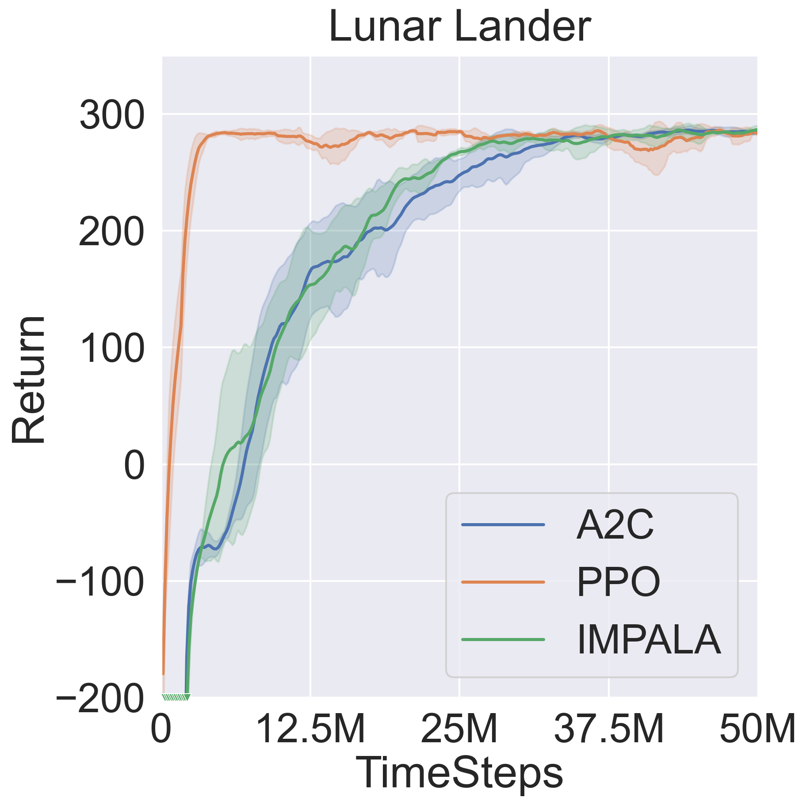
  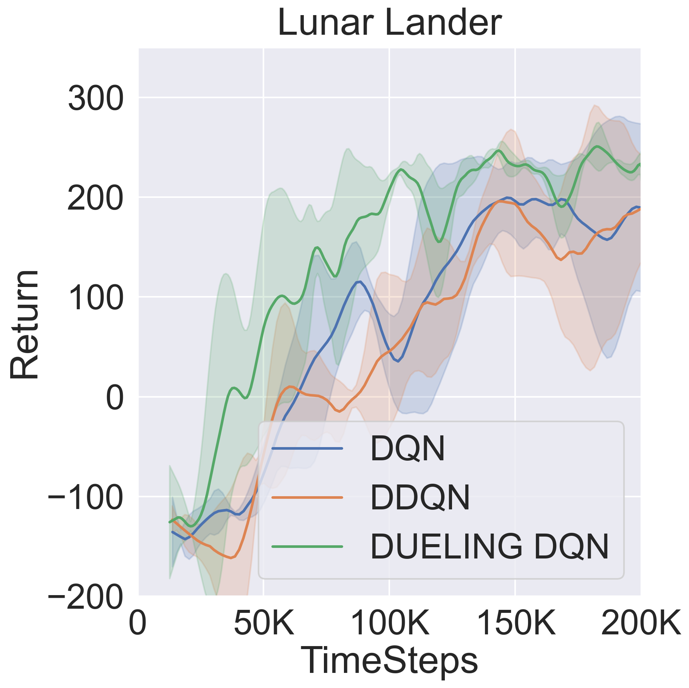
  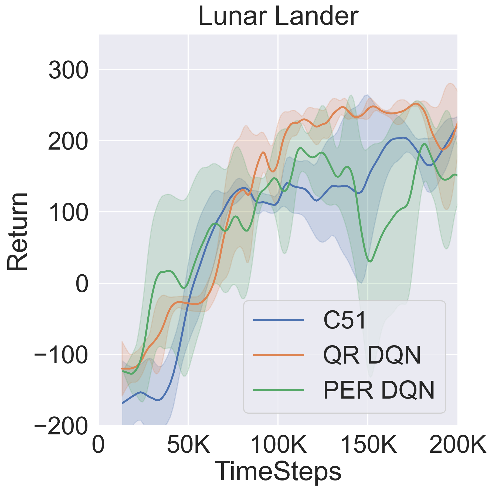
</p>

<p align="center"><em>LunarLander-v3: on-policy (left), off-policy-1 (center), and off-policy-2 (right) algorithm validation.</em></p>

<p align="center">
  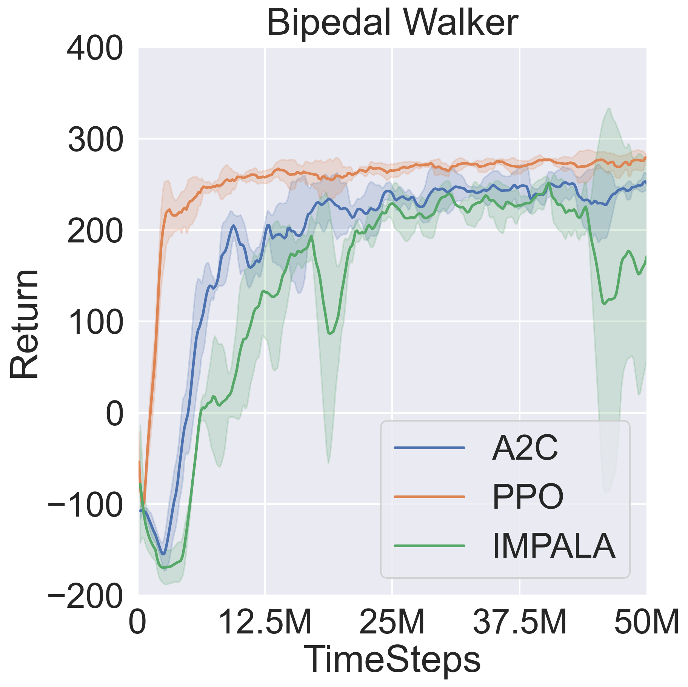
  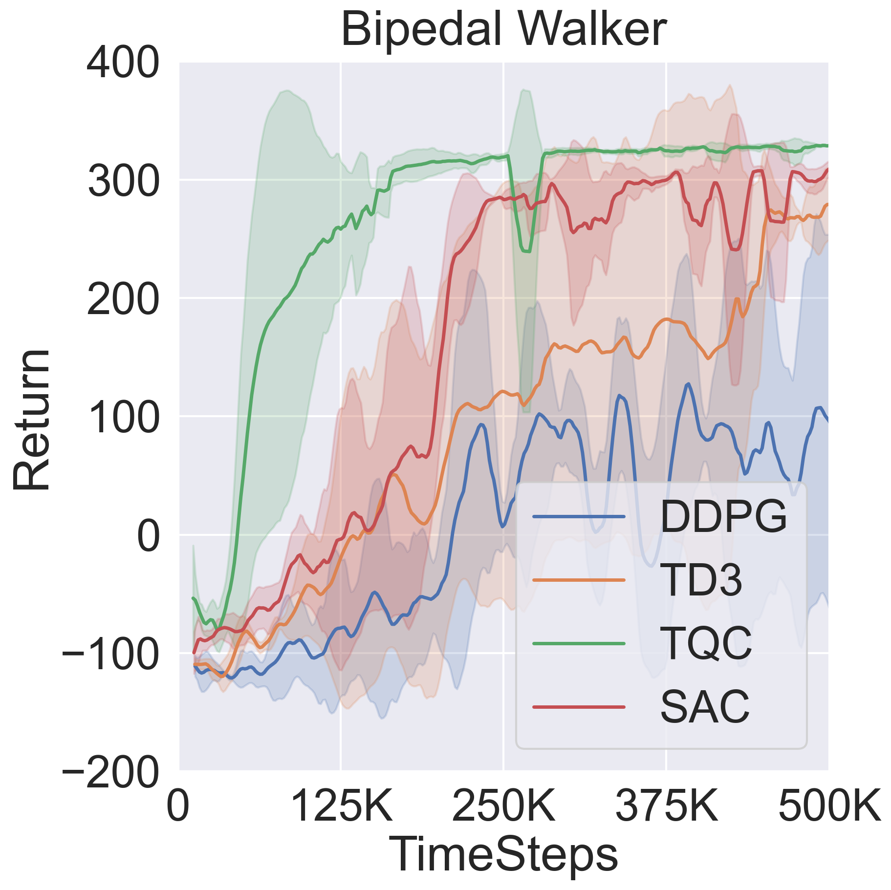
</p>

<p align="center"><em>BipedalWalker-v3: on-policy (left) and off-policy (right) algorithm validation.</em></p>

### Sampler scaling

This suite varies only the number of asynchronous IMPALA samplers. The training batch, learner count, environment, and total sample count remain fixed. IMPALA uses V-trace to correct for policy lag between samplers and the learner.

| Setting | Value |
| --- | --- |
| Algorithm | IMPALA |
| Environment | `LunarLander-v3` |
| Learners | 1 GPU learner |
| Samplers | 1, 2, 4, 8 |
| Seeds | 0, 1, 2 |
| Samples per run | 5,120,000 |
| Evaluation | 25 episodes |

Run the `impala-s<samplers>-<seed>` configurations sequentially to avoid resource contention:

```bash
python run.py --mode train --runner-config experiments/sampler_scaling/lunar_lander/impala-s1-0/train.yaml --agent-config experiments/sampler_scaling/lunar_lander/impala-s1-0/impala.yaml
```

The figures report the three-seed mean and standard deviation of wall-clock time, speedup relative to one sampler, and return versus wall-clock time.

<p align="center">
  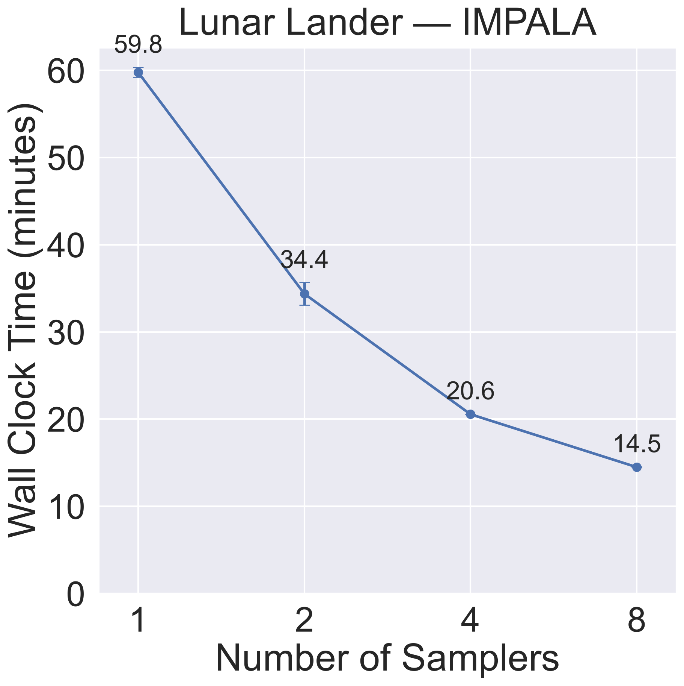
  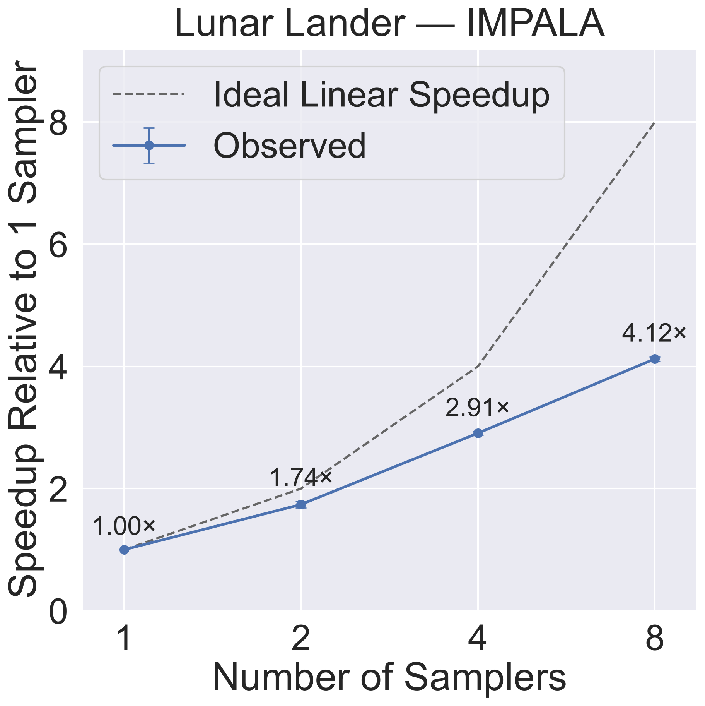
  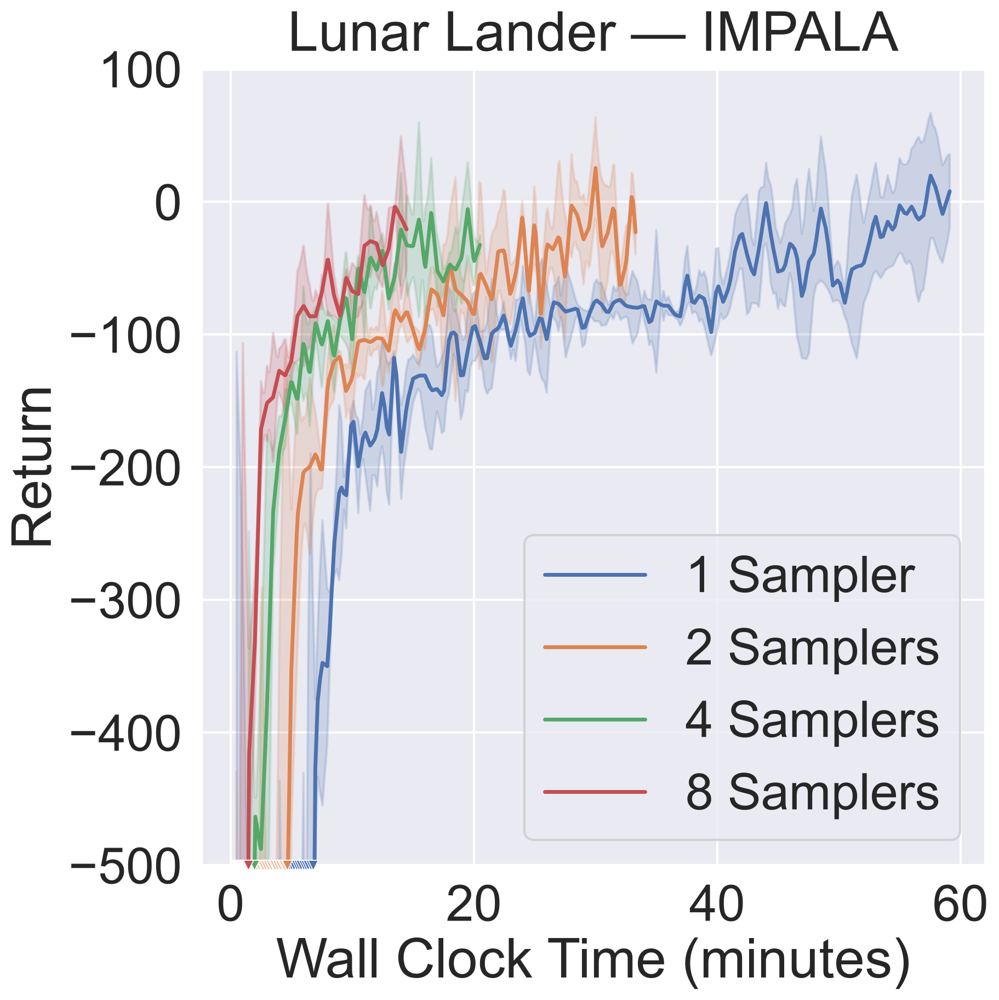
</p>

<p align="center"><em>IMPALA wall-clock time (left), speedup relative to one sampler (center), and return versus wall-clock time (right).</em></p>

### Evaluator scaling

This suite varies only the number of evaluator actors while keeping the algorithm, trained checkpoint, environment, and total evaluation workload fixed.

| Setting | Value |
| --- | --- |
| Algorithm | PPO |
| Environment | SUMO single intersection |
| Checkpoints | `agent_500.pth` from the matching environment-integration seed |
| Evaluators | 1, 2, 4, 8 |
| Seeds | 0, 1, 2 |
| Episodes per run | 40 |
| Episodes per evaluator | 40, 20, 10, 5 respectively |

Run the `ppo-e<evaluators>-<seed>` configurations sequentially:

```bash
python run.py --mode test --runner-config experiments/evaluator_scaling/sumo/single_intersection/ppo-e1-0/test.yaml --agent-config experiments/evaluator_scaling/sumo/single_intersection/ppo-e1-0/ppo.yaml
```

The configurations reuse the trained checkpoints under `results/environment_integration/sumo/single_intersection/ppo-<seed>`. The figures report the three-seed mean and standard deviation of wall-clock time and speedup relative to one evaluator.

<p align="center">
  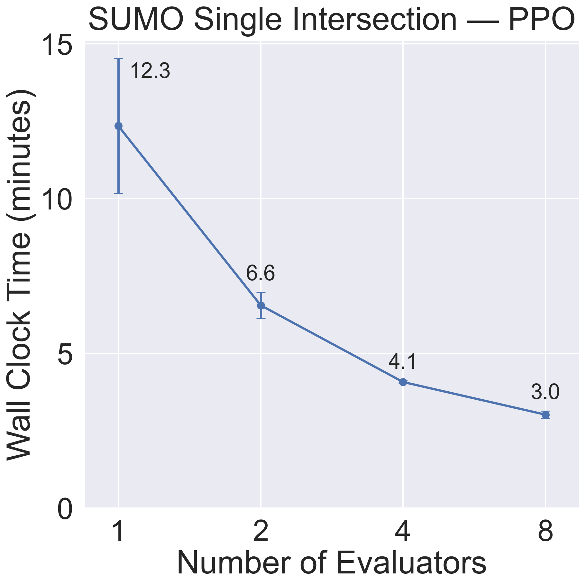
  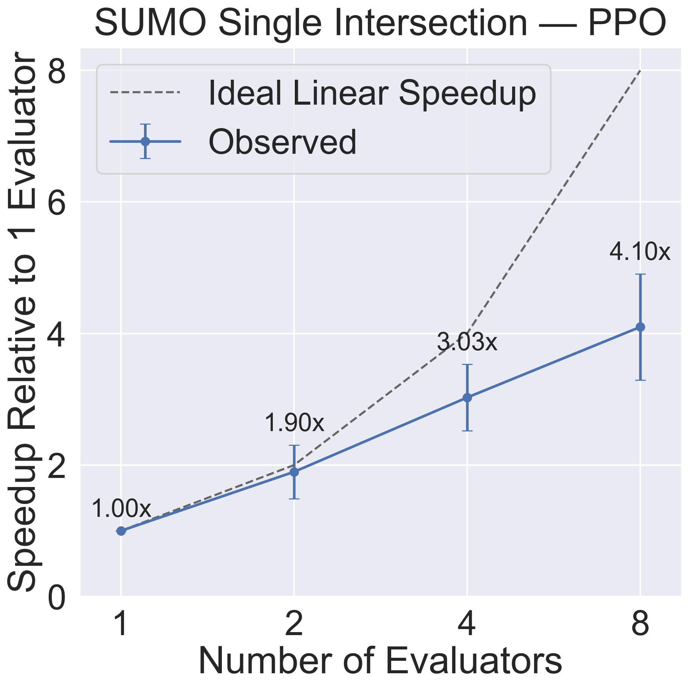
</p>

<p align="center"><em>SUMO evaluation wall-clock time (left) and paired speedup relative to one evaluator (right).</em></p>

### Environment integration

Environment backends encapsulate native interaction protocols, episode lifecycle, seeding, rendering, and domain-specific metrics. The runtime and algorithms depend only on the shared environment specification, collection loop, and evaluation interface, allowing the same PPO implementation to run unchanged across all three benchmarks.

| Backend | Benchmark | Backend-owned integration | Evaluation metrics | Samples per seed |
| --- | --- | --- | --- | ---: |
| `omnirl.envs.sumo` | SUMO single intersection | SUMO-RL/TraCI lifecycle, traffic-signal observations and fixed-horizon trip data | Delay, trip time, waiting time, queue length | 1,024,000 |
| `omnirl.envs.vizdoom` | ViZDoom Defend the Center | RGB frames, game tics and discrete button combinations | Kills, survival time, shots, shooting precision | 2,048,000 |
| `omnirl.envs.rlcard` | RLCard Blackjack | Active-player state, legal actions and terminal payoff | Win, draw and loss rates | 1,024,000 |

All three benchmarks use PPO with seeds 0, 1, and 2. Each backend reports domain-specific metrics rather than a mandatory generic `return_mean`.

Configurations are under `experiments/environment_integration/<backend>/<task>/ppo-<seed>`. Each run writes checkpoints, the merged configuration, and a `log.csv` containing runtime statistics and backend metrics under `results/environment_integration`.

The final training-time evaluations provide a compact snapshot of the recorded results:

| Benchmark | Training signal shown | Final value across three seeds |
| --- | --- | ---: |
| SUMO single intersection | Average waiting time (lower is better) | 39.45 ± 1.13 s |
| ViZDoom Defend the Center | Average kills per episode (higher is better) | 14.15 ± 1.34 |
| RLCard Blackjack | Win rate (higher is better) | 42.54% ± 0.21 pp |

Values are the mean ± sample standard deviation of the final logged evaluation for seeds 0, 1, and 2. In each plot, the solid line is the mean and the shaded region is one standard deviation.

<p align="center">
  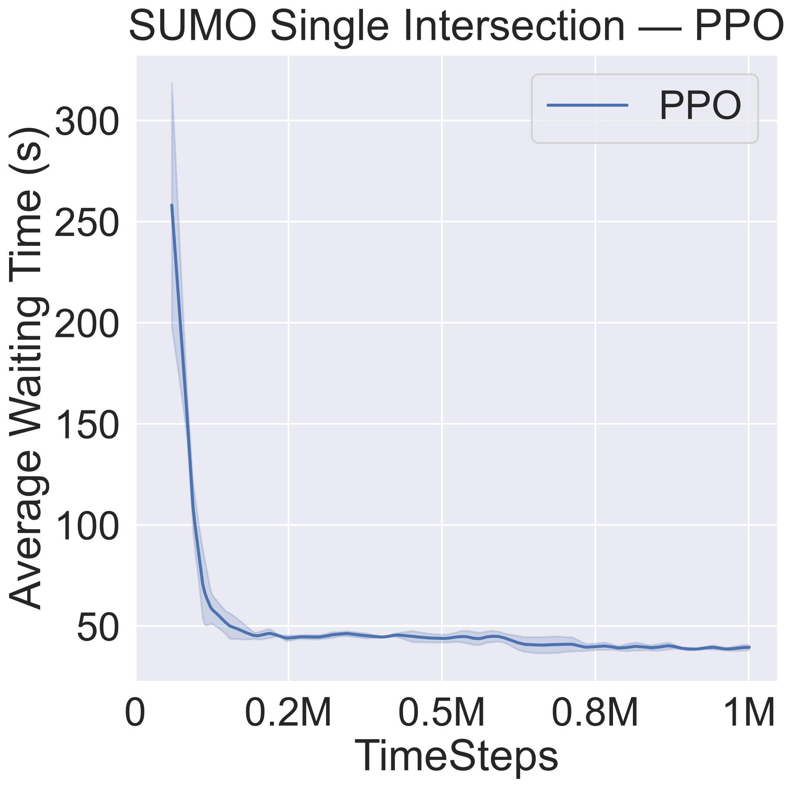
  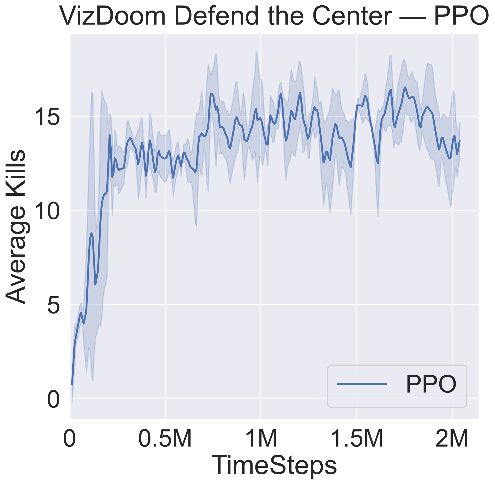
  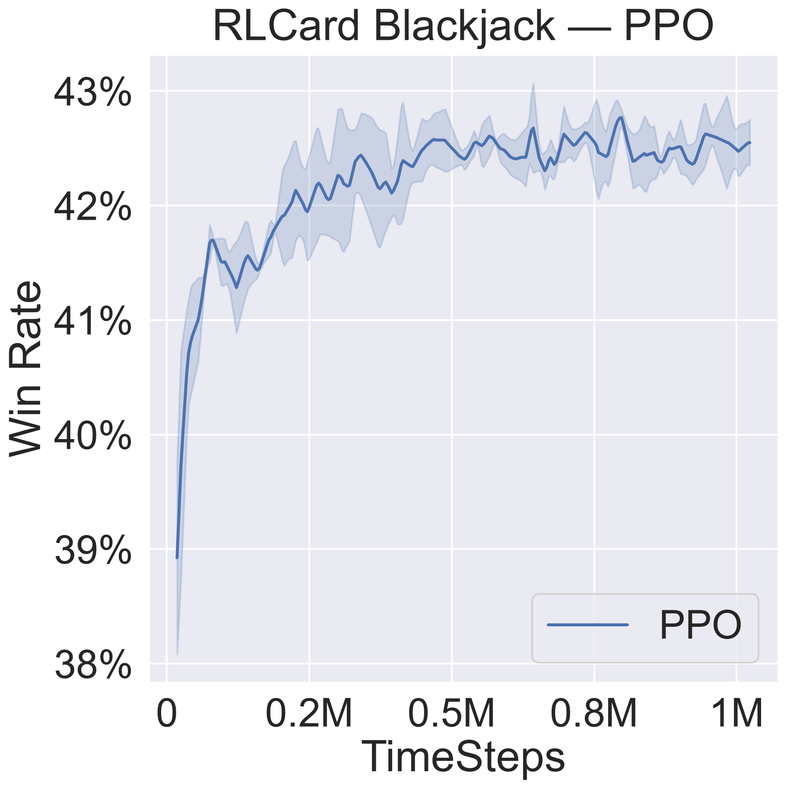
</p>

<p align="center"><em>SUMO average waiting time (left), ViZDoom average kills (center), and RLCard win rate (right).</em></p>

## Notes

- When training on CPU, set `device.learner` to `cpu` and keep `runner.num_learners` at `1`.
- Size `runner.num_samplers`, `runner.num_evaluators`, and `runner.num_learners` for the available hardware. As a starting point, keep their sum below 90% of the available CPU threads.
- Run the test suite with `python -m unittest discover -s tests -v`.
- OmniRL is a research framework. Multi-seed correctness reports and scaling results should be treated as experimental evidence rather than production guarantees.

## License

Copyright 2026 Huang Chenbiao (MBer123).

OmniRL is licensed under the [Apache License 2.0](LICENSE).
