# OmniRL

[English](README.md) | 简体中文

OmniRL 是一个基于 Python、Ray 和 PyTorch 的分布式强化学习框架。框架支持异步采样、经验存储与回放、分布式学习、权重同步、评估、日志记录和检查点恢复，内置 13 种 Value-based 和 Actor-Critic 算法，覆盖离散与连续控制任务。

## 架构

```text
Environment Collection ──► Samplers ──► Memory ──► Learners ──► WeightStore
                               ▲                                     │
                               └───────── Algorithm Policy ◄─────────┘

Environment Evaluation ◄── Evaluators ◄── Algorithm Policy ◄── WeightStore
```

- `omnirl.runtime` 负责调度采样、学习、评估和权重同步所需的 Ray Actor。
- `omnirl.buffers` 提供 Rollout Buffer、Replay Buffer 和 Prioritized Replay Buffer。
- `omnirl.algorithms` 包含各算法的 `Learner` 和 `Policy` 实现。
- `omnirl.networks` 提供可复用的 Value-based 与 Actor-Critic 网络结构。
- `omnirl.envs` 负责环境构建、环境规格定义、数据采集、评估和指标聚合。

所有算法包都导出统一的 `Learner`、`Policy` 和 `Memory` 接口。运行时通过这些接口组合算法与环境模块，使两者可以独立实现和扩展。

## 已实现算法

| 算法 | 类型 | 动作空间 |
| --- | --- | --- |
| ✅ [Deep Q-Network (DQN)](https://arxiv.org/abs/1312.5602) | Value-based，Off-policy | 离散 |
| ✅ [Double Deep Q-Network (DDQN)](https://arxiv.org/abs/1509.06461) | Value-based，Off-policy | 离散 |
| ✅ [Dueling Double Deep Q-Network (Dueling DQN)](https://arxiv.org/abs/1511.06581) | Value-based，Off-policy | 离散 |
| ✅ [Prioritized Experience Replay Deep Q-Network (PER-DQN)](https://arxiv.org/abs/1511.05952) | Value-based，Off-policy | 离散 |
| ✅ [Categorical 51-Atom Deep Q-Network (C51)](https://arxiv.org/abs/1707.06887) | Distributional Value-based，Off-policy | 离散 |
| ✅ [Quantile Regression Deep Q-Network (QR-DQN)](https://arxiv.org/abs/1710.10044) | Distributional Value-based，Off-policy | 离散 |
| ✅ [Advantage Actor-Critic (A2C)](https://arxiv.org/abs/1602.01783) | Actor-Critic，On-policy | 离散 / 连续 |
| ✅ [Proximal Policy Optimization (PPO)](https://arxiv.org/abs/1707.06347) | Actor-Critic，On-policy | 离散 / 连续 |
| ✅ [Importance Weighted Actor-Learner Architectures (IMPALA)](https://arxiv.org/abs/1802.01561) | Actor-Critic，Off-policy | 离散 / 连续 |
| ✅ [Deep Deterministic Policy Gradient (DDPG)](https://arxiv.org/abs/1509.02971) | Actor-Critic，Off-policy | 连续 |
| ✅ [Twin Delayed Deep Deterministic Policy Gradient (TD3)](https://arxiv.org/abs/1802.09477) | Actor-Critic，Off-policy | 连续 |
| ✅ [Soft Actor-Critic (SAC)](https://arxiv.org/abs/1801.01290) | Actor-Critic，Off-policy | 离散 / 连续 |
| ✅ [Truncated Quantile Critics (TQC)](https://arxiv.org/abs/2005.04269) | Distributional Actor-Critic，Off-policy | 连续 |

## 安装

OmniRL 支持 Python 3.10–3.12。首先创建虚拟环境：

```bash
python -m venv .venv
```

在 Windows 上激活虚拟环境：

```powershell
.\.venv\Scripts\Activate.ps1
```

在 Linux 和 macOS 上：

```bash
source .venv/bin/activate
```

安装 OmniRL 及其基础依赖：

```bash
python -m pip install --upgrade pip
pip install -e .
```

根据任务安装所需的环境模块依赖：

```bash
# Gymnasium
pip install -r requirements/gymnasium.txt

# RLCard
pip install -r requirements/rlcard.txt

# SUMO
pip install -r requirements/sumo.txt

# ViZDoom
pip install -r requirements/vizdoom.txt
```

每个环境模块的依赖文件都会引入 `base.txt`，因此在全新环境中直接安装对应文件即可。

如需使用 GPU 训练，请安装与操作系统和 CUDA 运行时相匹配的 PyTorch 版本，然后确认 CUDA 是否可用：

```bash
python -c "import torch; print(torch.cuda.is_available())"
```

## 快速开始

运行 OmniRL 需要两份 YAML 配置：

- Runner 配置用于定义环境、Ray Worker 数量、设备、随机种子、检查点和日志。
- Agent 配置用于定义算法模块，以及 `Learner`、`Memory`、`Policy` 和网络参数。

在单机上启动 `LunarLander-v3` 的 PPO 训练：

```bash
python run.py --mode train --runner-config experiments/algorithm_validation/lunar_lander/ppo-0/train.yaml --agent-config experiments/algorithm_validation/lunar_lander/ppo-0/ppo.yaml
```

如果检测到可用的 Ray 集群，`run.py` 会直接连接；否则会启动本地 Ray 运行时。多节点运行时，先启动 Head 节点：

```bash
ray start --head --port=6379
```

让各 Worker 节点加入集群，然后在 Head 节点上启动 `run.py`：

```bash
ray start --address=<head-ip>:6379
```

当 `runner.load_checkpoint` 为 `true` 时，重新执行相同的训练命令会从 `runner.ckpt_dir` 中的 `checkpoint.ckpt` 恢复训练。

### 输出

每次运行都会将以下文件写入 `runner.ckpt_dir`：

- `checkpoint.ckpt`：用于恢复训练的完整 `Learner` 状态和优化器状态。
- `agent_<version>.pth`：导出的策略权重。
- `log.csv`：运行时、评估和 `Learner` 指标。
- `run_config.yaml`：本次运行实际使用的 Runner 与 Agent 合并配置文件。

## 评估

在对应的 `test.yaml` 中设置 `runner.ckpt_dir` 和 `runner.eval_model`，然后运行：

```bash
python run.py --mode test --runner-config experiments/algorithm_validation/lunar_lander/ppo-0/test.yaml --agent-config experiments/algorithm_validation/lunar_lander/ppo-0/ppo.yaml
```

评估指标由所选环境模块定义。总评估回合数为 `runner.num_evaluators * runner.num_episodes`。

当环境模块支持交互式渲染时，请在测试配置中将 `env.render_mode` 设置为 `human`，并将 `runner.num_evaluators` 设置为 `1`。

## 添加算法

在 `omnirl/algorithms/<name>/` 下创建算法包，并导出统一的运行时接口：

```python
from .learner import Learner
from .policy import Policy
from omnirl.buffers import ReplayBuffer as Memory

__all__ = ["Learner", "Memory", "Policy"]
```

算法模块需要提供：

- `Learner`：负责参数更新、检查点保存和带版本权重访问的 Ray Actor，可参考现有实现的接口。
- `Policy`：提供确定性 `choose_action` 和探索性 `sample_action` 方法的本地推理类。
- `Memory`：`omnirl.buffers` 中的一种 Buffer，或符合相同接口的新 Ray Actor。
- 如果算法需要新的网络架构，请在 `omnirl.networks` 下定义网络。
- 一份 Agent YAML 配置，其中 `agent.module` 指向 `omnirl.algorithms.<name>`，`modules` 部分提供各组件的构造参数。

无需修改环境模块和分布式运行时。将新算法加入上表前，请添加模块接口测试和学习器更新测试。

## 添加环境模块

在 `omnirl/envs/<name>/` 下创建一个包，并导出：

```python
EnvAdapter
build_env
get_env_spec
CollectionLoop
EvaluationLoop
aggregate_evaluations
```

`get_env_spec` 用于描述观测的形状与数据类型、动作的维度与边界以及默认评估指标。`CollectionLoop` 将策略输出转换为 Rollout 数据；`EvaluationLoop` 和 `aggregate_evaluations` 负责生成并聚合环境特定的评估指标。

在 Runner 配置中指定环境模块：

```yaml
env:
  module: omnirl.envs.gymnasium
  id: CartPole-v1
  render_mode: null
```

`module` 用于选择环境模块；`env` 中的其余配置会原样传递给该模块。

算法和运行时 Actor 只依赖这组统一接口，无需导入具体的环境模块，也无需包含环境模块专用配置。

## 实验

`experiments` 目录包含四组可复现实验：

| 实验组 | 用途 | 运行次数 |
| --- | --- | ---: |
| 算法验证 | 在离散和连续控制任务上比较全部 13 种已实现算法。 | 48 |
| Sampler 扩展性 | 使用三个随机种子，比较 IMPALA 配置 1、2、4、8 个异步 Sampler 时的性能。 | 12 |
| Evaluator 扩展性 | 使用三个随机种子，在固定 SUMO 评估负载下比较 1、2、4、8 个 Evaluator。 | 12 |
| 环境集成 | 使用 PPO 验证三个非 Gymnasium 环境模块。 | 9 |
| **总计** |  | **81** |

每次训练都使用 `results/` 下的独立目录，并启用检查点恢复。

### 算法验证

每种环境与算法组合均使用随机种子 0、1、2：

| 环境 | 算法 | 随机种子 |
| --- | --- | --- |
| `LunarLander-v3` | A2C、C51、DDQN、DQN、Dueling DQN、IMPALA、PER-DQN、PPO、QR-DQN | 0、1、2 |
| `BipedalWalker-v3` | A2C、DDPG、IMPALA、PPO、SAC、TD3、TQC | 0、1、2 |

基于 Rollout 的算法使用 10 个 Sampler，并执行 24,415 次参数更新。基于 Replay 的算法使用 1 个 Sampler，Replay Ratio 为 1；LunarLander 的批大小为 128，BipedalWalker 的批大小为 256，两者均执行 250,000 次参数更新。每次评估由两个 Evaluator 汇总 50 个回合。

训练并评估一次实验：

```bash
python run.py --mode train --runner-config experiments/algorithm_validation/bipedal_walker/ppo-0/train.yaml --agent-config experiments/algorithm_validation/bipedal_walker/ppo-0/ppo.yaml
python run.py --mode test --runner-config experiments/algorithm_validation/bipedal_walker/ppo-0/test.yaml --agent-config experiments/algorithm_validation/bipedal_walker/ppo-0/ppo.yaml
```

检查点、日志和合并后的运行配置将写入 `results/algorithm_validation/<environment>/<algorithm>-<seed>`。

<p align="center">
  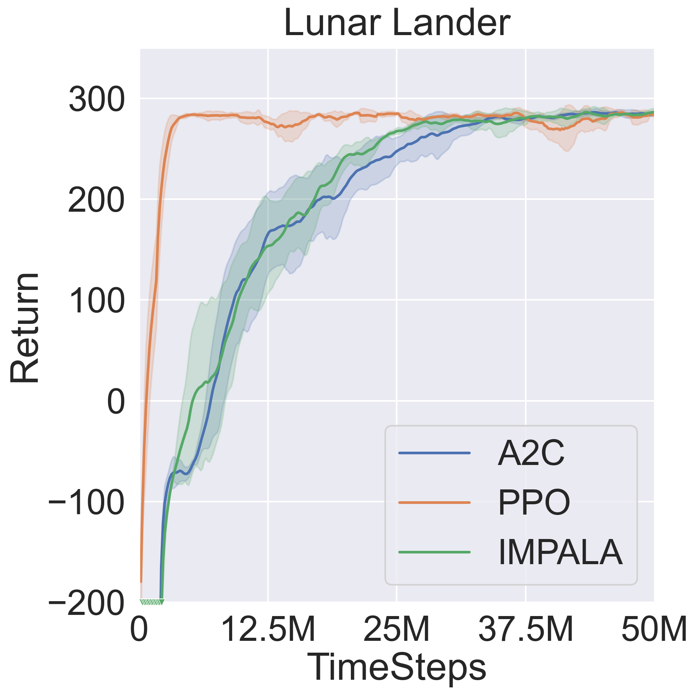
  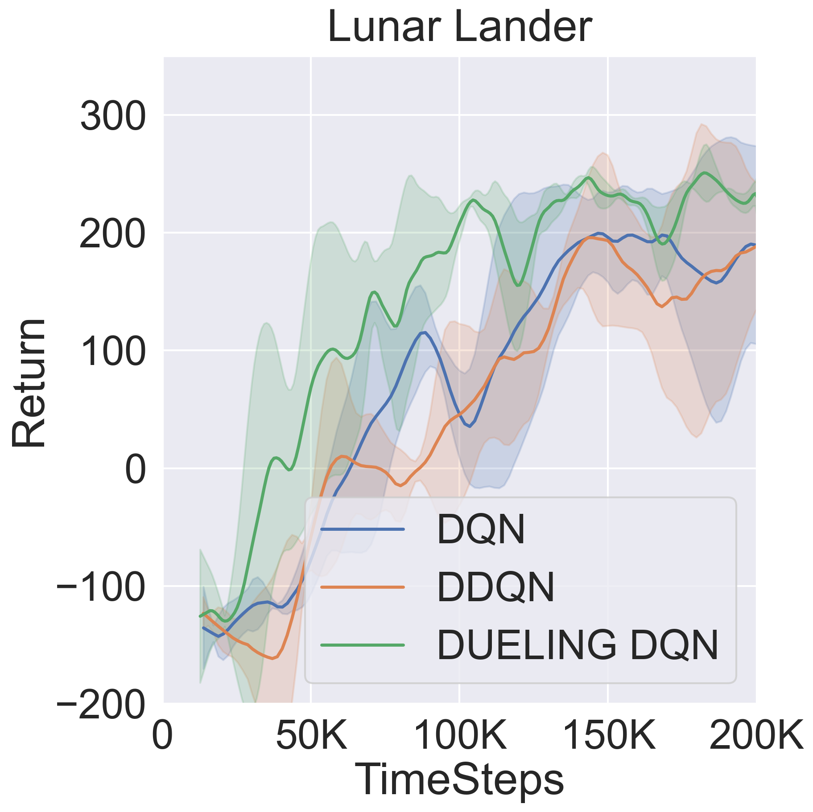
  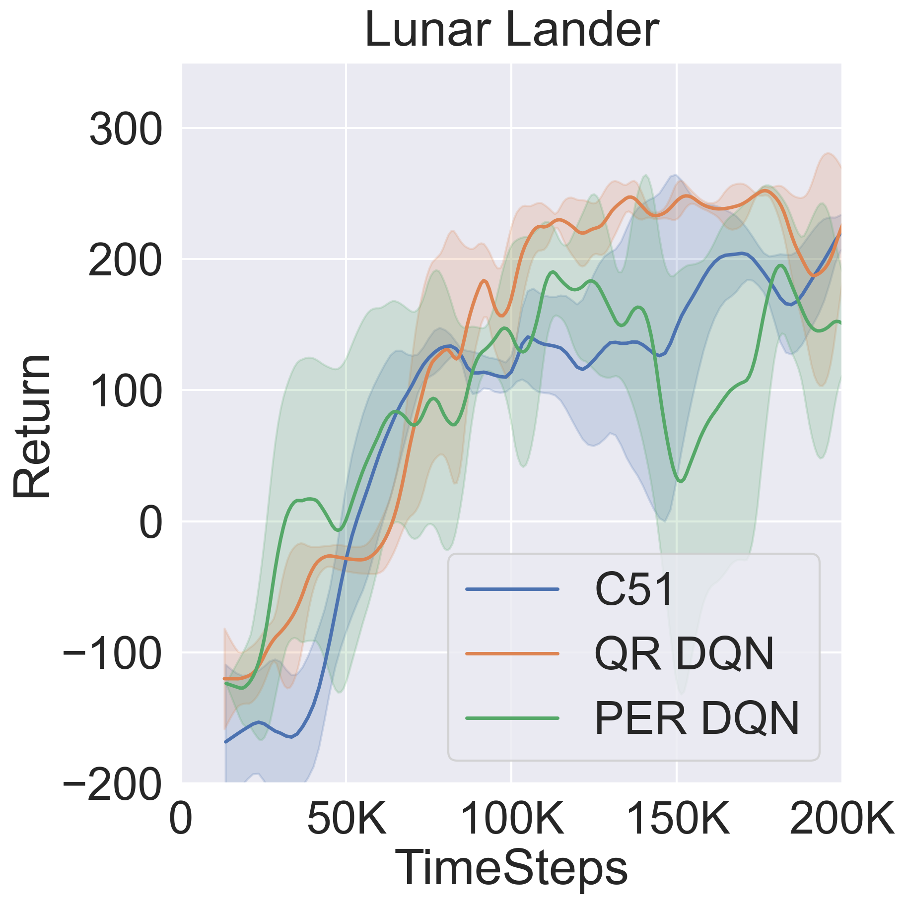
</p>

<p align="center"><em>LunarLander-v3：On-policy 算法（左）、第一组 Off-policy 算法（中）和第二组 Off-policy 算法（右）的验证结果。</em></p>

<p align="center">
  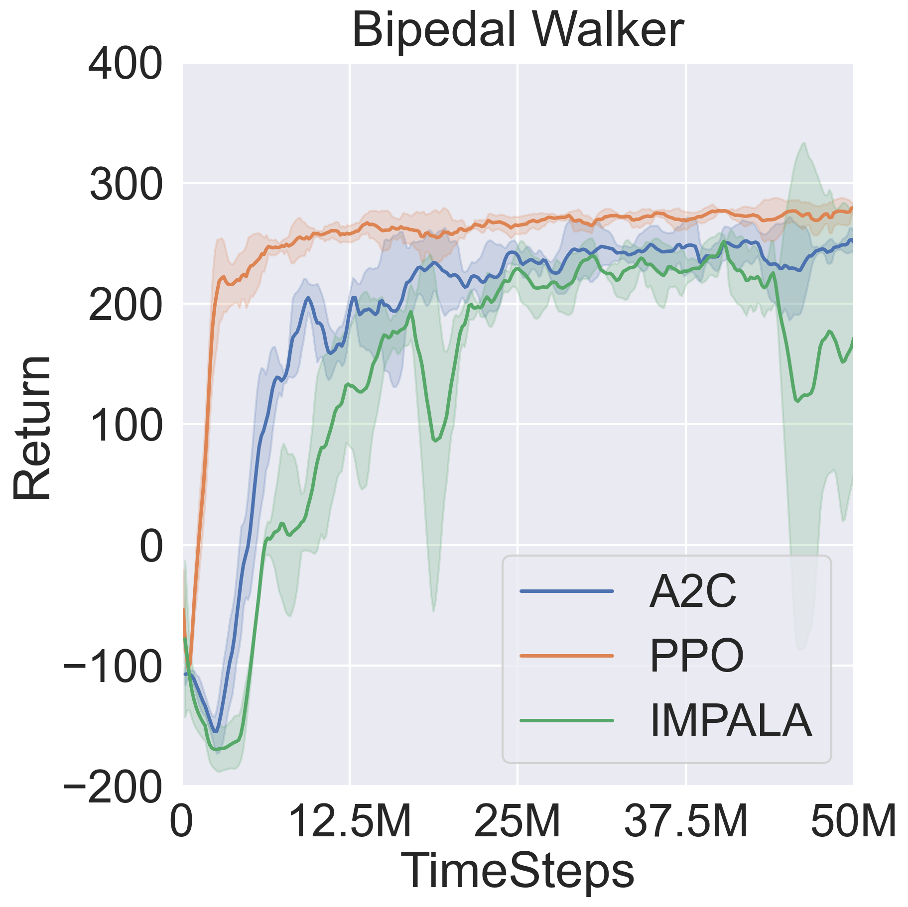
  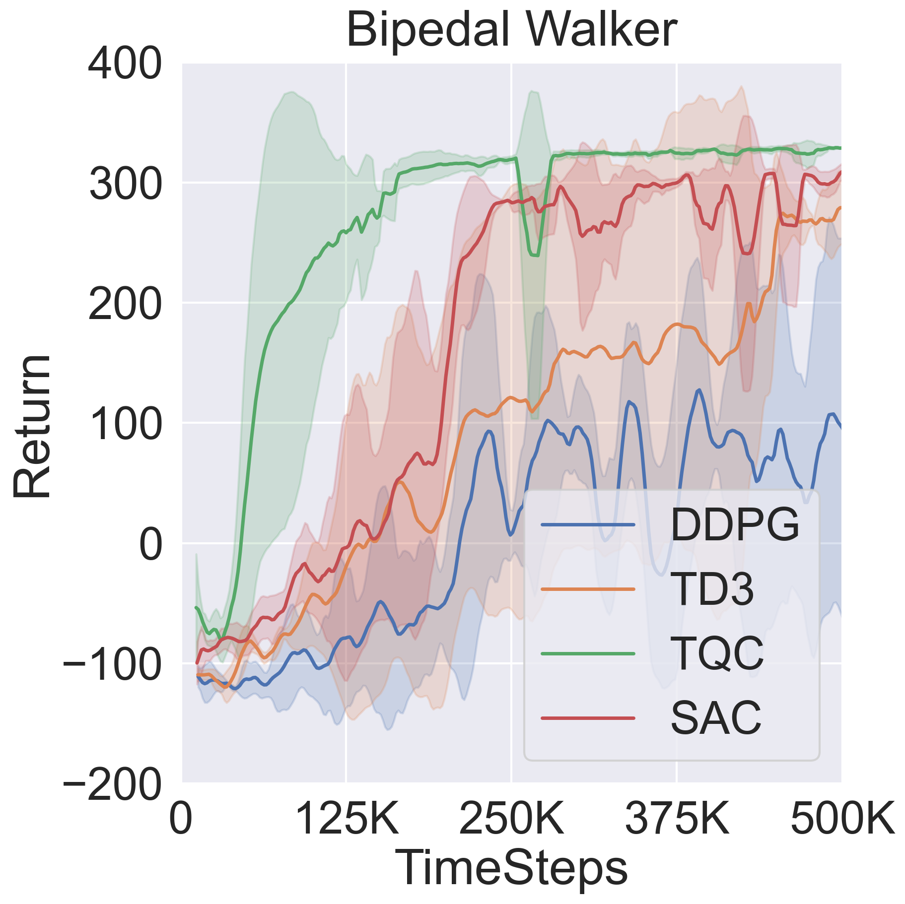
</p>

<p align="center"><em>BipedalWalker-v3：On-policy 算法（左）和 Off-policy 算法（右）的验证结果。</em></p>

### Sampler 扩展性

该实验只改变 IMPALA 的异步 Sampler 数量，训练批次设置、Learner 数量、环境和总采样量均保持不变。IMPALA 使用 V-trace 修正 Sampler 与 Learner 之间的 Policy Lag。

| 设置 | 值 |
| --- | --- |
| 算法 | IMPALA |
| 环境 | `LunarLander-v3` |
| Learner | 1 个 GPU Learner |
| Sampler | 1、2、4、8 |
| 随机种子 | 0、1、2 |
| 每次运行的样本数 | 5,120,000 |
| 评估 | 25 个回合 |

请依次运行 `impala-s<samplers>-<seed>` 配置，避免多个实验争用资源：

```bash
python run.py --mode train --runner-config experiments/sampler_scaling/lunar_lander/impala-s1-0/train.yaml --agent-config experiments/sampler_scaling/lunar_lander/impala-s1-0/impala.yaml
```

下图展示三个随机种子的实际耗时均值与标准差、相对于单 Sampler 的加速比，以及回报随实际运行时间的变化。

<p align="center">
  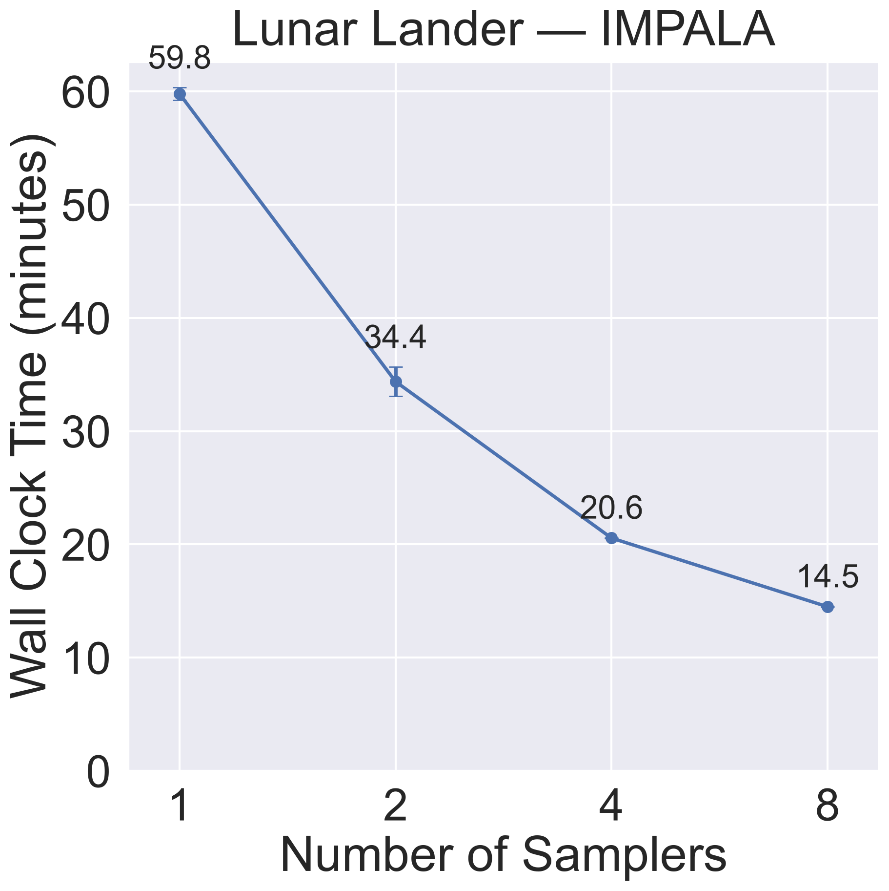
  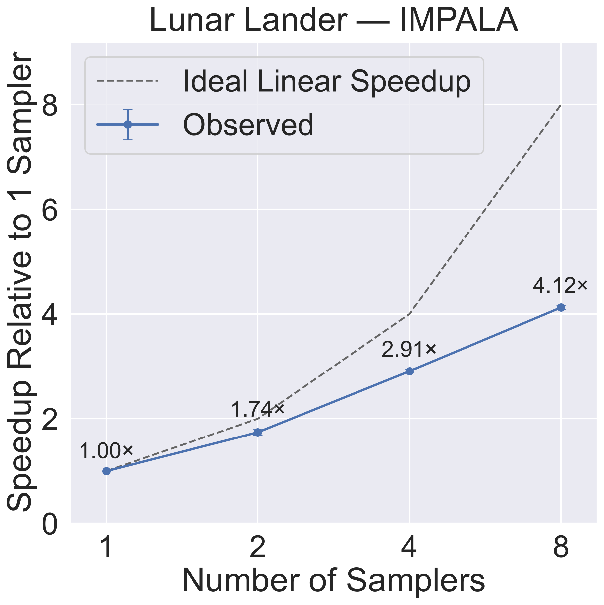
  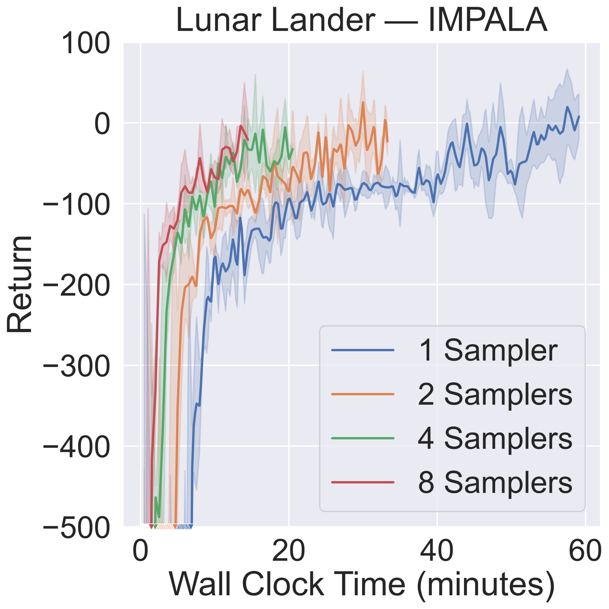
</p>

<p align="center"><em>IMPALA 实际耗时（左）、相对于单 Sampler 的加速比（中）以及回报随运行时间的变化（右）。</em></p>

### Evaluator 扩展性

该实验只改变 Evaluator Actor 的数量，算法、已训练的检查点、环境和总评估负载均保持不变。

| 设置 | 值 |
| --- | --- |
| 算法 | PPO |
| 环境 | SUMO 单路口 |
| 检查点 | 对应环境集成随机种子的 `agent_500.pth` |
| Evaluator | 1、2、4、8 |
| 随机种子 | 0、1、2 |
| 每次运行的回合数 | 40 |
| 每个 Evaluator 的回合数 | 分别为 40、20、10、5 |

请依次运行 `ppo-e<evaluators>-<seed>` 配置：

```bash
python run.py --mode test --runner-config experiments/evaluator_scaling/sumo/single_intersection/ppo-e1-0/test.yaml --agent-config experiments/evaluator_scaling/sumo/single_intersection/ppo-e1-0/ppo.yaml
```

这些配置会复用 `results/environment_integration/sumo/single_intersection/ppo-<seed>` 下已训练的检查点。下图展示三个随机种子的实际耗时均值与标准差，以及相对于单 Evaluator 的加速比。

<p align="center">
  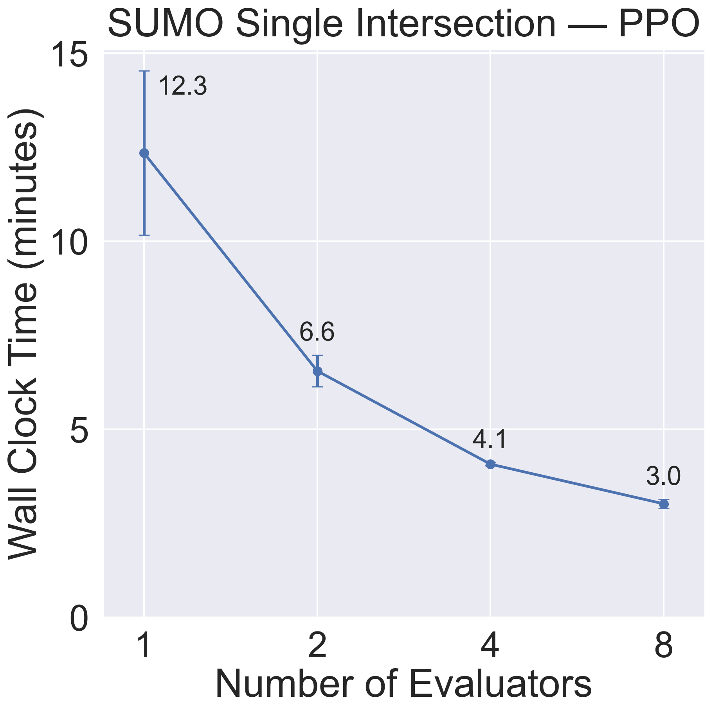
  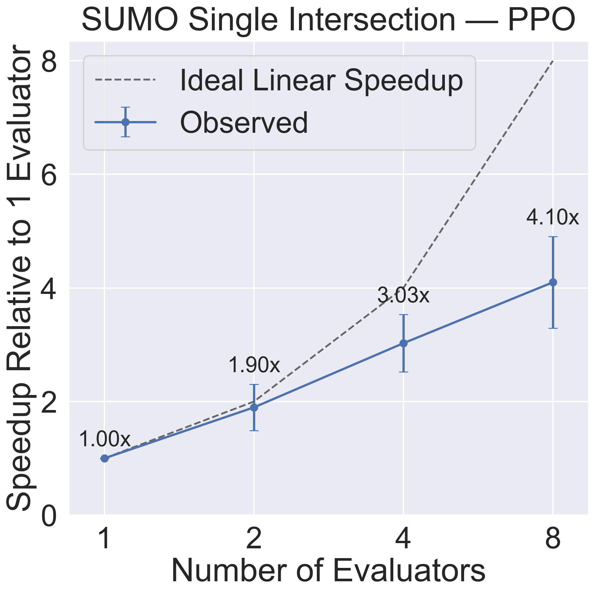
</p>

<p align="center"><em>SUMO 评估耗时（左），以及相对于单 Evaluator、按相同随机种子配对计算的加速比（右）。</em></p>

### 环境集成

环境模块封装原生交互协议、回合生命周期、随机种子、渲染和任务特定指标。运行时与算法只依赖统一的环境规格、采集循环和评估接口，因此同一份 PPO 实现无需修改即可运行在三个基准任务上。

| 环境模块 | 基准任务 | 环境模块负责的集成内容 | 评估指标 | 每个随机种子的样本数 |
| --- | --- | --- | --- | ---: |
| `omnirl.envs.sumo` | SUMO 单路口 | SUMO-RL/TraCI 生命周期、交通信号观测和固定评估时长内的车辆行程数据 | 延误、行程时间、等待时间、队列长度 | 1,024,000 |
| `omnirl.envs.vizdoom` | ViZDoom Defend the Center | RGB 画面、Game Tic 和离散按键组合 | 击杀数、生存时间、射击数、射击精度 | 2,048,000 |
| `omnirl.envs.rlcard` | RLCard Blackjack | 当前玩家状态、合法动作和终局收益 | 胜率、平局率、败率 | 1,024,000 |

三个基准任务均使用 PPO，并在随机种子 0、1、2 下各运行一次。每个环境模块只报告与任务相关的指标，不强制提供通用的 `return_mean`。

配置位于 `experiments/environment_integration/<backend>/<task>/ppo-<seed>`。每次运行都会在 `results/environment_integration` 下写入检查点、合并后的运行配置，以及包含运行时统计和环境指标的 `log.csv`。

下表汇总各随机种子在训练期间最后一次评估的结果：

| 基准任务 | 展示的训练指标 | 三个随机种子的最终值 |
| --- | --- | ---: |
| SUMO 单路口 | 平均等待时间（越低越好） | 39.45 ± 1.13 秒 |
| ViZDoom Defend the Center | 每回合平均击杀数（越高越好） | 14.15 ± 1.34 |
| RLCard Blackjack | 胜率（越高越好） | 42.54% ± 0.21 个百分点 |

表中数值为上述最终记录在三个随机种子上的均值 ± 样本标准差。下图中，实线表示均值，阴影区域表示一个标准差。

<p align="center">
  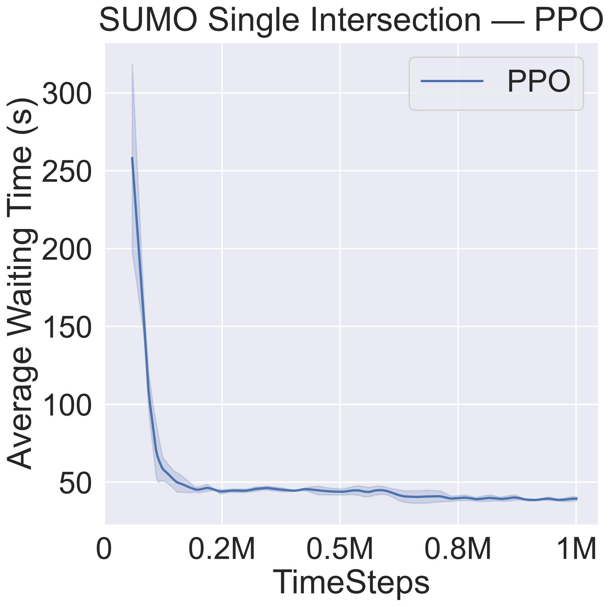
  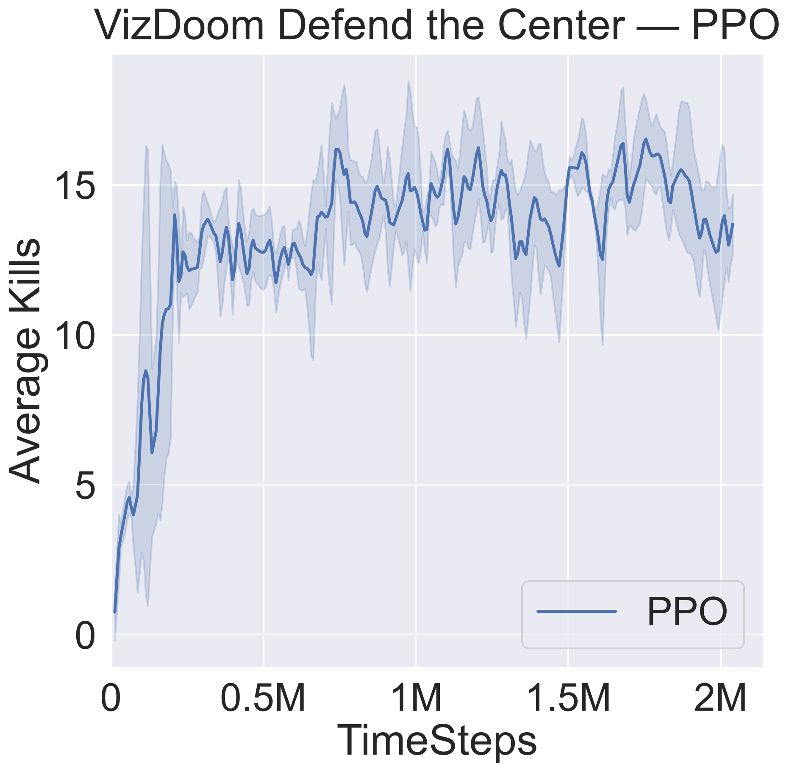
  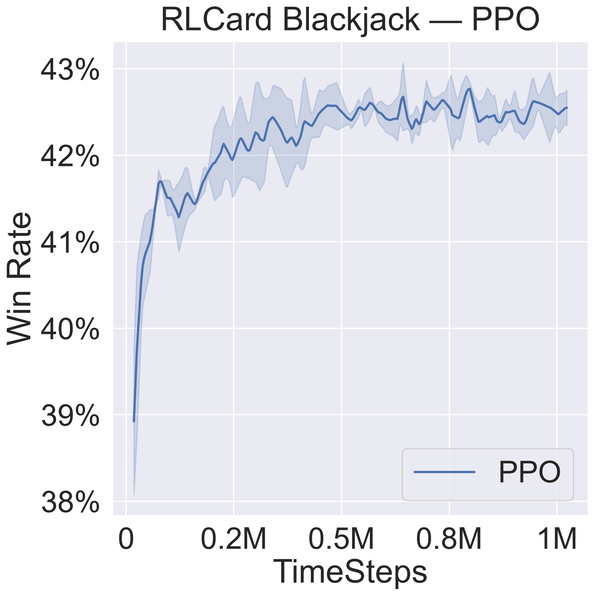
</p>

<p align="center"><em>SUMO 平均等待时间（左）、ViZDoom 平均击杀数（中）和 RLCard 胜率（右）。</em></p>

## 注意事项

- 使用 CPU 训练时，请将 `device.learner` 设置为 `cpu`，并保持 `runner.num_learners` 为 `1`。
- 请根据可用硬件调整 `runner.num_samplers`、`runner.num_evaluators` 和 `runner.num_learners`。初次配置时，建议将三者总数控制在可用 CPU 线程数的 90% 以下。
- 使用 `python -m unittest discover -s tests -v` 运行测试套件。
- OmniRL 面向强化学习研究。基于多个随机种子的算法验证和扩展性结果仅代表当前实验条件，不构成生产级保证。

## 许可证

Copyright 2026 Huang Chenbiao (MBer123).

本项目采用 [Apache License 2.0](LICENSE) 开源许可证。
